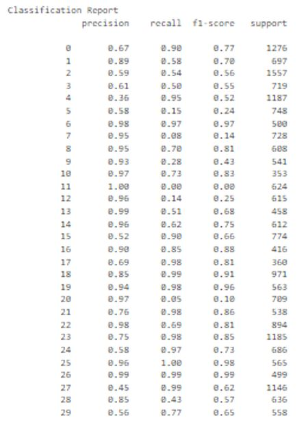
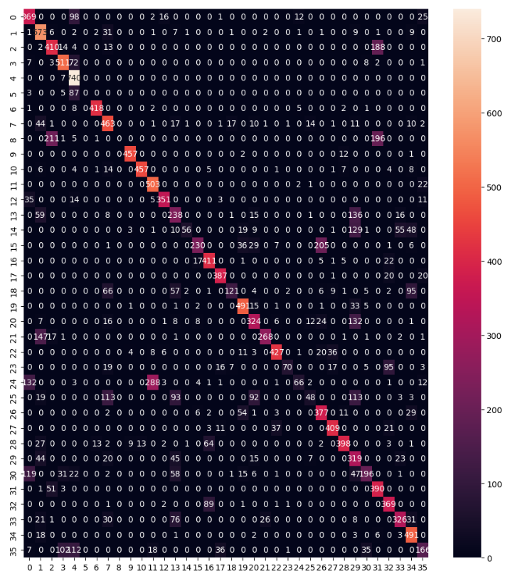

# Indian Sign Language Recognition System

Real-time recognition of Indian Sign Language (ISL) fingerspelling — the ten digits
and the twenty-six letters of the alphabet — from an ordinary webcam.

*Lakshmi Seema Pramod and Anjali S Kumar · supervised by Prof. Reshna S ·
Department of Electronics and Communication*

The system extracts 21 hand landmarks per frame with [MediaPipe Hands](https://developers.google.com/mediapipe),
normalises them into a scale- and translation-invariant feature vector, and classifies
them with a small feed-forward neural network trained in TensorFlow/Keras and deployed
as a quantised TFLite model. No gloves, depth cameras or motion-capture rigs are needed —
the aim was a translator that runs on cheap, portable hardware.

<p align="center">
  
</p>

## Why

Communicating with someone who is deaf or hard of hearing is difficult if you do not
know sign language. Prior work in this area leans on expensive or cumbersome hardware:
full-body motion-capture suits, inertial sensor gloves that restrict hand movement, or
the discontinued Microsoft Kinect. This project set out to do the recognition step with
nothing but a camera and a few megabytes of model, so the same approach can be deployed
on something like a Raspberry Pi with a speaker attached.

## How it works

```
webcam frame
    │
    ├─ MediaPipe Hands ──► 21 (x, y) hand landmarks
    │
    ├─ pre-processing ───► coordinates made relative to the wrist,
    │                      flattened to 42 values, normalised by the
    │                      largest absolute value
    │
    └─ MLP classifier ───► one of 36 classes (0–9, A–Z)
                            └─► label drawn on the frame
```

The classifier is deliberately tiny, because the input is already a compact geometric
description of the hand rather than raw pixels:

| Layer | Shape | Notes |
|---|---|---|
| Input | 42 | 21 landmarks × (x, y) |
| Dropout | — | rate 0.2 |
| Dense | 20 | ReLU |
| Dropout | — | rate 0.4 |
| Dense | 10 | ReLU |
| Dense | 37 | softmax (36 classes are used; see *Known issues*) |

Trained with Adam, sparse categorical cross-entropy, batch size 128, 75/25 train/test
split, early stopping with patience 20.

## Results

**74% overall accuracy** across the 36 classes on a held-out test set of 16,685 samples.

| Metric | Precision | Recall | F1 |
|---|---|---|---|
| Macro average | 0.69 | 0.61 | 0.59 |
| Weighted average | 0.68 | 0.63 | 0.61 |

The headline number hides the result that actually matters. Macro F1 is 0.59 against
74% accuracy — a 15-point gap that says performance is spread very unevenly across the
alphabet, and the confusion matrix shows exactly where it goes wrong.

<p align="center">
  
</p>

Three groups come out of this:

**Recognised reliably.** `9` (F1 0.98), `A` (0.98), `6` (0.93), `S` (0.86), `C` (0.85),
`L` (0.84), `M` (0.84), `W` (0.82). These are signs whose fingertips land in distinctive
positions when projected onto the image plane.

**Absorbed by other classes.** `5` (recall 0.02), `8` (0.03), `E` (0.11), `U` (0.13),
`N` (0.25), `I` (0.29), `O` (0.30). These are rarely predicted at all — the model has
learned to route them elsewhere. Note that `8` has precision 1.00: when it *is*
predicted it is always right, it just almost never fires.

**Over-predicted attractors.** The mirror image of the above: `4` (precision 0.33,
recall 0.97), `V` (0.42 / 0.94), `G` (0.58 / 0.93), `B` (0.62 / 0.92). High recall,
poor precision — they swallow the classes that collapse.

That attractor/collapse pairing is the signature of a feature representation that has
thrown away the information needed to separate certain signs. The classifier sees only
**2-D** landmark positions, so two ISL signs that differ mainly in finger *depth*, or in
which fingers occlude which, project to nearly the same 42 numbers. No amount of
training on those features will separate them; the fix is a richer representation, not a
bigger network. See *Known issues* for what to try.

The full per-class breakdown is in
[`docs/results/classification-report.png`](docs/results/classification-report.png).

> **On reproducibility:** this project went through several training runs on different
> dataset snapshots, and the 74% figure above is the one reported in
> `docs/report/`. The `keypoint_classifier.tflite` and `.hdf5` committed here come from
> a different run (71.8% on a 29,285-sample split), so re-running the evaluation against
> the committed weights will not reproduce 74% exactly. The conference abstract
> (`docs/report/Conference-abstract.docx`) reports 80% for a further configuration.

## Dataset

`model/keypoint_classifier/keypoint.csv.gz` — 117,139 labelled samples across the
36 classes, collected by recording landmark vectors from live webcam capture using the
logging mode built into `app.py`. Each row is `class_id` followed by 42 normalised
coordinates.

Class counts are unbalanced, ranging from 1,378 samples (class 17, `H`) to 10,363
(class 2, `2`), which contributes to the uneven per-class results above.

The file is gzipped to keep the repository clone small. Unpack it before training:

```bash
python scripts/prepare_dataset.py
```

## Running it

Requires Python 3.10 (MediaPipe's Python wheels were pinned to ≤3.10 at the time this
was built) and a webcam.

```bash
pip install -r requirements.txt
python app.py
```

Options:

| Flag | Default | Meaning |
|---|---|---|
| `--device` | `0` | camera index |
| `--width` | `960` | capture width |
| `--height` | `540` | capture height |
| `--use_static_image_mode` | off | treat each frame independently |
| `--min_detection_confidence` | `0.7` | MediaPipe detection threshold |
| `--min_tracking_confidence` | `0.5` | MediaPipe tracking threshold |

Keys while running:

| Key | Action |
|---|---|
| `k` | switch to logging mode — append landmarks to `keypoint.csv` |
| `0`–`9` | in logging mode, record under class 0–9 (the digits) |
| `a`–`z` | in logging mode, record under class 10–35 (the letters) |
| `Esc` | quit |

The key-to-class mapping in `select_mode()` was extended from the upstream project to
cover `a`–`z`, which is how the letter classes in the dataset were collected. Note that
the `n` (back to normal inference) and `h` bindings are commented out, so once logging
mode is entered the app has to be restarted to leave it.

### Retraining

1. `python scripts/prepare_dataset.py` to unpack the dataset
2. Collect any additional samples with `app.py` in logging mode (`k`)
3. Run `keypoint_classification.ipynb` end to end — it writes
   `keypoint_classifier.hdf5` and the quantised `keypoint_classifier.tflite`
4. Keep `keypoint_classifier_label.csv` in step with the class ids

## Repository layout

```
app.py                              real-time recognition application
keypoint_classification.ipynb       training and TFLite conversion
model/keypoint_classifier/          classifier, trained weights, labels, dataset
utils/cvfpscalc.py                  FPS counter
scripts/prepare_dataset.py          unpacks keypoint.csv.gz
experiments/text_to_speech.py       standalone pyttsx3 / gTTS spike (not wired into app.py)
docs/report/                        project report and conference abstract
docs/results/                       confusion matrix and classification report
docs/design/                        block diagram, flowcharts, design document
docs/notes/                         implementation notes, proposal, literature survey
docs/images/                        ISL reference charts and demo screenshots
```

## Known issues and next steps

- **Speech output is not integrated.** `experiments/text_to_speech.py` is a standalone
  spike; the recognition loop only draws the predicted label on screen. Wiring it in
  needs a debounce step so a stable prediction over several frames triggers one
  utterance rather than one per frame.
- **`NUM_CLASSES` is 37 in the notebook but only 36 labels exist**, so the softmax has
  one output that can never be correct. Harmless, but it should be 36.
- **Only single-handed, static signs.** The point-history classifier from the upstream
  project, which handles dynamic finger gestures, was removed. Double-handed ISL signs
  and motion-based signs are not covered.
- **Depth-ambiguous letters are the accuracy ceiling.** MediaPipe already returns a `z`
  coordinate per landmark that this pipeline discards; feeding 63 features instead of 42
  is a small change and the most direct attack on the collapse/attractor pairing in the
  results. Adding inter-landmark angles or distances, or a short temporal window, are the
  next candidates.
- **Class imbalance** in the training data is uncorrected — class weights or
  resampling would likely lift the weakest classes.
- **Evaluation is not reproducible from the repo as it stands.** The committed weights
  and the reported 74% come from different runs on different dataset snapshots (see
  *Results*). Fixing this means re-running the notebook on the committed dataset with a
  fixed seed and recording that single number everywhere.

## Literature reviewed

The approaches this project was positioned against, with the reasons they were not
pursued, are summarised in `docs/notes/project-proposal.txt` and
`docs/notes/literature-survey.txt`:

- Kumar et al., "S3DRGF: Spatial 3-D Relational Geometric Features for 3-D Sign Language
  Representation and Recognition," *IEEE Signal Processing Letters*, 26(1), 2019, pp. 169–173.
  doi:10.1109/LSP.2018.2883864 — accurate, but needs a 17-sensor motion-capture suit.
- "Inertial Motion Sensing Glove for Sign Language Gesture Acquisition and Recognition,"
  *IEEE Sensors Journal*, 16(16), 2016, pp. 6310–6316. doi:10.1109/JSEN.2016.2583542 —
  sensors across the upper limb restrict natural hand movement.
- "A Prototype for Mexican Sign Language Recognition and Synthesis in Support of a
  Primary Care Physician," *IEEE Access*, 10, 2022, pp. 127620–127635.
  doi:10.1109/ACCESS.2022.3226696 — built on Kinect, now discontinued, and needs
  clear physical space.

The PDFs themselves are not redistributed here; follow the DOIs.

## Attribution and licence

This project is a derivative work of
[Kazuhito00/hand-gesture-recognition-using-mediapipe](https://github.com/Kazuhito00/hand-gesture-recognition-using-mediapipe)
(via [kinivi/hand-gesture-recognition-mediapipe](https://github.com/kinivi/hand-gesture-recognition-mediapipe),
the English-translated fork), licensed under Apache 2.0. The MediaPipe landmark
extraction, landmark pre-processing, drawing code, FPS counter and the training
notebook's structure come from that project.

Licensed under the Apache License 2.0 — see [`LICENSE`](LICENSE). A summary of what was
changed for ISL recognition is in [`NOTICE`](NOTICE).
